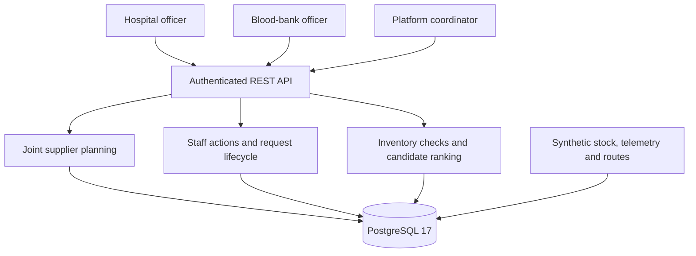

# Team Relay: HemoGrid emergency blood dispatch

> **The closest blood bank is not always the right one.**

**Terumo BCT Africa Hackathon 2026 · Emergency request and dispatch**

**[Launch the live app](https://hemogrid-eight.vercel.app/login)** · **[Watch the demo video](https://www.tella.tv/video/hemogrid-emergency-blood-dispatch-dt1odmiq)** · **[View the 8-slide deck](https://docs.google.com/presentation/d/1E3NaYlyrvygwXysVymFKq4qBNCi22wb428WnZNdBTfE/edit?slide=id.p1#slide=id.p1)** · **[Judges' two-minute project guide](https://github.com/Team-Relay/hemo-grid-frontend/blob/main/docs/JUDGE_START_HERE.md)** · [Frontend source and primary README](https://github.com/Team-Relay/hemo-grid-frontend) · [Hosted transaction proof](https://github.com/Team-Relay/hemo-grid-frontend/actions/runs/42952475072)

**This is the backend and evaluation repository**, not a second product. The frontend handles staff workflows; this service owns matching, quarantine checks, shared-stock planning, authorization, reservations and transactional state. Together they form **one HemoGrid submission**.

HemoGrid helps a hospital blood-bank officer turn an urgent request into a supplier proposal, a staff decision and a reserved order. It brings recorded stock, quarantine status, configured blood-group rules and corridor travel estimates into one workflow. The supplying bank confirms the request before stock is reserved. A coordinator can also preview a complete supplier plan for two to five staff-approved critical red-cell requests competing for the same inventory.

## The problem

The user is a hospital blood-bank officer handling an urgent request. Finding a nearby facility is one part of the job. The officer also needs enough usable stock, a supplying bank willing to fulfil the order and an honest transport estimate. Availability can change while staff coordinate the transfer.

The imported synthetic network contains 47 facilities, 2,162 corridor routes, 225 aggregate inventory rows and 2,500 historical request records. In our reproducible snapshot comparison, a distance-only choice produced an ineligible proposal for 749 of 1,072 emergency red-cell requests. These are failures of the prototype's configured inventory checks in synthetic data. The comparison gives the officer a concrete reason to check feasibility before arranging transport. The full method and results appear below.

## What we built

One deployed application connects **hospital staff, blood-bank staff and a network coordinator**. The coordinator's joint plan is advisory and cannot accept orders or reserve stock on behalf of either institution.

1. A hospital officer creates a request with the component, group, quantity and urgency.
2. HemoGrid ranks provider candidates and returns stock, quarantine and route evidence for each proposal.
3. The officer selects an eligible provider, changes that choice or cancels the request.
4. The supplying blood-bank officer accepts or declines. Acceptance reserves inventory under database locks.
5. Staff progress the order through preparation, transit and delivery. Delivery consumes the reservation. Cancellation before dispatch returns the reservation.

### What works now

- Hospital and blood-bank authentication with organization-scoped request access.
- Candidate ranking by full fulfilment, recorded cold-chain eligibility, configured group preference, estimated transit time and available stock.
- Joint supplier planning for two to five staff-approved critical red-cell requests, with shared stock limits, a nearest eligible comparison and explicit infeasibility or search-limit results.
- Plain-language explanations of the proposed inventory match and transport assumptions.
- Stock revalidation when the hospital selects a provider and when the bank accepts.
- Inventory row locks and request locks for competing acceptances and repeated calls.
- Cold-chain holds checked at acceptance and before fulfilment progresses. A hold returns HTTP 409 with `COLD_CHAIN_HOLD`.
- Request state transitions, cancellation, reservation accounting and timestamped milestones.
- PostgreSQL schema and synthetic data through Flyway, Docker configuration, health probes and an OpenAPI interface.

### What is mocked or not finished

- Temperature readings and routes come from synthetic seed data. Live sensor ingestion and live traffic are future integrations.
- The current data model tracks aggregate stock by facility, blood group and component. Unit-level traceability, expiry decisions and laboratory crossmatch workflows require further work.
- The demonstration and benchmark focus on red-cell dispatch. Clinical validation and component-specific handling for other products remain outstanding.
- SMS, USSD, a complete offline client and automatic rerouting after acceptance remain future work.
- The coordinator Dispatch Planning interface and core operational workflows are live on Vercel. The demonstration video and eight-slide deck are linked below.

### Coordinator planning

A platform coordinator can read pending requests with `GET /api/v1/dispatch-plans/requests` and submit their selected IDs to `POST /api/v1/dispatch-plans/preview`. The preview leaves stock unchanged. Each hospital approves its own supplier choice and each bank confirms its reservation through the existing workflow. [Dispatch planning API](docs/DISPATCH_PLANNING.md)

### Live links and demo

| Item | Location or status |
| --- | --- |
| Primary project guide | [Judges' guide and demo walkthrough](https://github.com/Team-Relay/hemo-grid-frontend/blob/main/docs/JUDGE_START_HERE.md) |
| Demo video, at most 3 minutes | [Watch HemoGrid on Tella](https://www.tella.tv/video/hemogrid-emergency-blood-dispatch-dt1odmiq) |
| Pitch deck, at most 8 slides | [View the Team Relay pitch deck](https://docs.google.com/presentation/d/1E3NaYlyrvygwXysVymFKq4qBNCi22wb428WnZNdBTfE/edit?slide=id.p1#slide=id.p1) |
| Hosted frontend | [HemoGrid Web App](https://hemogrid-eight.vercel.app) |
| Hosted backend | [Swagger UI](https://hemo-grid-backend.onrender.com/swagger-ui.html) · [Health](https://hemo-grid-backend.onrender.com/actuator/health) |
| Local interactive API | [Swagger UI](http://localhost:8080/swagger-ui.html) |
| Local readiness probe | [Readiness](http://localhost:8080/actuator/health/readiness) |
| API contract and frontend handoff | [Frontend API handoff](docs/FRONTEND_API_HANDOFF.md) |

**The complete hosted synthetic transaction passed:** one A-positive red-cell request was created, selected, accepted, reserved, prepared, marked in transit and delivered. Stock reconciled from **10 available to 9**, with no outstanding reservation. [Review the recorded run](https://github.com/Team-Relay/hemo-grid-frontend/actions/runs/42952475072). This was a software test, not a physical shipment.

The demo should follow staff-approved requests through a coordinator preview, hospital provider selection and bank reservation. Show the nearest eligible comparison, the shared stock evidence and a changed recommendation or quarantine hold.

Synthetic demo accounts are seeded for local evaluation.

| Role | Email | Password |
| --- | --- | --- |
| Hospital officer | `hospital.demo@hemogrid.local` | `HospitalDemo123!` |
| Nairobi blood-bank officer | `bank.demo@hemogrid.local` | `BankDemo123!` |
| Embu blood-bank officer | `embu.bank@hemogrid.local` | `BankDemo123!` |
| Mombasa blood-bank officer | `mombasa.bank@hemogrid.local` | `BankDemo123!` |
| Kisumu blood-bank officer | `kisumu.bank@hemogrid.local` | `BankDemo123!` |
| Nakuru blood-bank officer | `nakuru.bank@hemogrid.local` | `BankDemo123!` |
| Eldoret blood-bank officer | `eldoret.bank@hemogrid.local` | `BankDemo123!` |
| Nyeri satellite bank officer | `nyeri.bank@hemogrid.local` | `BankDemo123!` |
| Network administrator | `admin.demo@hemogrid.local` | `AdminDemo123!` |

## How to run it

Use Java 21 with its compiler module, Docker Compose and a free local port 8080. The Maven wrapper supplies Maven.

```bash
git clone https://github.com/Team-Relay/hemo-grid-backend.git
cd hemo-grid-backend
cp .env.example .env
docker compose up -d postgres
./mvnw spring-boot:run
```

Flyway creates and seeds the schema at startup. Open Swagger, log in through `POST /api/v1/auth/login`, and authorize with the returned bearer token.

Create a request as the hospital officer.

```json
{
  "bloodGroup": "O_NEGATIVE",
  "component": "RED_CELLS",
  "unitsRequired": 3,
  "urgency": "CRITICAL",
  "unknownPatientBloodGroup": false,
  "clinicalReference": "SYNTHETIC-DEMO-001",
  "notes": "Synthetic emergency dispatch demonstration"
}
```

| Staff action | Endpoint |
| --- | --- |
| Create a hospital request | `POST /api/v1/blood-requests` |
| Read ranked proposals | `GET /api/v1/blood-requests/{id}/candidates` |
| Select or change the provider while requested | `POST /api/v1/blood-requests/{id}/select-provider` |
| Bank accepts and reserves stock | `POST /api/v1/provider/requests/{id}/accept` |
| Bank declines | `POST /api/v1/provider/requests/{id}/decline` |
| Bank progresses fulfilment | `POST /api/v1/provider/requests/{id}/status` |
| Hospital cancels before dispatch | `POST /api/v1/blood-requests/{id}/cancel` |

Provider selection takes `{"providerOrganizationId":"<candidate organization UUID>"}`. Status updates take `{"status":"PREPARING"}`, then `IN_TRANSIT`, then `DELIVERED`. Switch to the supplying bank's account for provider actions. Each bank account belongs to its own seeded organization. Use the account for the selected provider. The regional accounts are introduced by migration V8.

### Verify the workflow

The Spring integration suite uses a disposable PostgreSQL database and resets its fixtures. Create the test database once, then run the suite against it.

```bash
docker compose exec postgres createdb -U hemogrid hemogrid_test
DB_URL=jdbc:postgresql://localhost:5432/hemogrid_test ./mvnw test
```

Tests cover the HTTP workflow, authorization, matching, cancellations, repeated acceptance and competing requests. Added regressions cover a quarantine recorded after hospital selection and after reservation, including preparation, transit and delivery. See the [test guide](docs/TESTING.md).

| Verification for this revision | Result |
| --- | --- |
| Compilation of shared ranking and compatibility policy, followed by the offline benchmark | Passed |
| Repeatable benchmark output against the unchanged V7 seed | Passed |
| Planner checks against exhaustive enumeration on 2,000 cases, plus changed stock and concurrent calls | Passed |
| Controlled batch comparison across 3,321 scenario batches | Passed |
| Full Spring/PostgreSQL regression suite, including cross-role concurrency and readiness checks | **Passed on `main`.** [Latest backend verification](https://github.com/Team-Relay/hemo-grid-backend/actions/runs/42944446515) |

## Architecture



A Spring Boot modular monolith separates authentication, organizations, inventory, matching and requests. PostgreSQL stores reservations and lifecycle milestones. Candidate records preserve the evidence shown at recommendation time. Inventory is rechecked before staff actions commit. This workflow could sit between a hospital requisition interface and a blood service's stock and transport systems.

| Standard | Relationship to the prototype |
| --- | --- |
| HL7 FHIR | Requests and facilities provide conceptual mapping points for SupplyRequest and Location. FHIR import, export and conformance validation remain future integrations. |
| ISBT 128 | Product and component identification are integration targets. The prototype currently uses internal component enums and aggregate inventory. |
| DHIS2 | Facility and activity reporting are potential integration points. The seed uses synthetic facility codes. Registry synchronization remains future work. |

## AI and data

### What the AI or data feature does

The new feature is a small constrained allocation planner. It considers two to five critical red-cell requests selected by staff, applies current stock and quarantine checks to existing provider candidates, and finds one supplier for every included request with the lowest summed estimated transport time. Every included request remains mandatory. A bounded search reports whether the plan is optimal, feasible, infeasible or unresolved within its search budget.

The preview shows current stock evidence and leaves stock unchanged. Hospital officers approve their own supplier selections and banks confirm reservations using the existing endpoints. The planner coordinates supplier choices within the selected batch. Clinical priority, suitability and release decisions remain with qualified personnel.

The data feature is deterministic dispatch ranking. It reads configured compatibility options, stock, recorded quarantine status and corridor estimates. Full fulfilment and recorded eligibility come first. Group preference precedes transit time, followed by spare capacity and a stable name tie-break. The API and offline evaluation share the compatibility policy and `DispatchPriority` ordering.

The ranking runs locally against the application database. Explanations are generated from those recorded values and assumptions. Qualified personnel retain responsibility for clinical suitability, laboratory checks and release authorization.

### Baseline we compared against

The comparison includes two simple baselines. **Nearest site** chooses the closest active blood bank by straight-line distance, then checks whether its inventory can fulfil the request. **Nearest eligible** applies the same configured group, stock and quarantine checks before choosing the closest facility. HemoGrid applies its existing preference and transit ordering to that eligible set.

### Result

The batch comparison uses 1,072 known-group emergency RBC request shapes from V7. Consecutive chronological requests form controlled batches of two, three or five. The same options, quantities and scenario stock are supplied to both methods. The nearest eligible baseline consumes stock sequentially, while the joint planner considers assignments together.

Across sizes and scenarios, 3,321 controlled batch comparisons were evaluated. The five-request results are shown here.

| Scenario | Complete batches, nearest eligible | Complete batches, planner | Batches complete under both | Reduction in summed estimated journey hours on paired complete batches |
| --- | --- | --- | --- | --- |
| Seed inventory snapshot | 187 / 214 | 187 / 214 | 187 | 0.20% |
| Each stock row capped at four units | 146 / 214 | 150 / 214 | 146 | 4.96% |
| One blood bank newly quarantined per batch | 186 / 214 | 186 / 214 | 186 | 0.18% |

These are constructed stress scenarios using synthetic request shapes and route estimates. Each batch starts with a fresh scenario snapshot, and stock is shared within that batch. The stock-capped scenario is an imposed scarcity condition. The original snapshot shows a smaller transport difference and equal complete-batch coverage. Reported transport reductions use only batches both methods could completely fill.

Reproduce all sizes and scenarios with `bash scripts/benchmark_batch_dispatch.sh`. The [batch summary](docs/batch-dispatch-benchmark.json) contains all nine scenario rows, and the command writes a request-ID trace for every batch. [Method and API details](docs/DISPATCH_PLANNING.md)

#### Independent-request comparison

The cohort contains **1,072 emergency RBC requests with known blood groups**, dated **9 September to 31 October 2026**, from the **2,500 requests imported in V7**. Each request is evaluated independently against the same seeded inventory snapshot. The remaining 1,428 records fall outside this cohort.

| Measure | Nearest site | Nearest eligible | HemoGrid |
| --- | --- | --- | --- |
| Eligible full-quantity proposals | 323 / 1,072 | 1,044 / 1,072 | 1,044 / 1,072 |
| Suggestions failing configured stock or quarantine checks | 749 / 1,072 | 0 / 1,072 | 0 / 1,072 |
| Requests left without an eligible proposal | 0, although 749 suggestions fail checks | 28 / 1,072 | 28 / 1,072 |
| Exact-group proposals among eligible results | 308 / 323 | 958 / 1,044 | 1,043 / 1,044 |
| Mean estimated transit on the same 1,044 eligible requests | Different cohort | 4.359 hours | 4.589 hours |

On the paired eligible requests, transit estimates were equal in 959 cases and longer under HemoGrid in 85. Its exact-group preference explains the tradeoff. Staff can review the alternatives and change the proposed provider. The current result supports feasibility screening and explicit inventory preference. Further work is needed to establish a transport advantage over nearest eligible dispatch.

This evaluation measures proposals at one synthetic inventory snapshot. Requests leave the snapshot unchanged. Historical stock reconstruction, actual journey times, queueing, preparation delays and patient outcomes require separate evaluation. The zero counts refer to these configured checks on this cohort.

Reproduce the independent-request comparison with Java 21 and Bash.

```bash
bash scripts/benchmark_dispatch.sh
```

The command compiles the shared policies and writes `target/dispatch-benchmark/summary.json` and a request-by-request `requests.csv`. The checked-in [benchmark summary](docs/dispatch-benchmark.json) records the input SHA-256. The [benchmark implementation](scripts/DispatchBenchmark.java) makes the cohort, eligibility checks and denominators inspectable.

### How a user sees the reason for a recommendation

Each candidate includes the offered group, available stock snapshot, ability to fill the order, recorded temperature, excluded quarantined units, estimated transit and `recommendationReasons`. ETA explanations distinguish a seeded corridor estimate from straight-line distance at an assumed 45 km/h. Historical error bounds are uncalibrated, and staff are told to confirm transport and additional preparation or approval delays. A missing estimate is explicitly reported as unavailable.

### Who approves it (Accept / Change / Reject)

The coordinator acknowledges staff approval of every request included in a batch. The hospital officer selects the provider for its own request. The supplying bank accepts before reservation. Officers can change the selected candidate while the request is `REQUESTED`, cancel while cancellation is permitted, or decline as the supplying bank. A recommendation becomes an operational order through those staff actions.

### What happens if the AI is wrong or offline

**Joint planning fails or returns no complete plan:** This deterministic planner requires no external model inference service. If its preview endpoint returns an error, `INFEASIBLE` or `LIMIT_REACHED`, a coordinator must not treat the batch as an approved allocation. The frontend now explicitly offers a **Manual dispatch fallback**: the hospital officer signs into the existing single-request workflow, refreshes current candidates, and individually approves an eligible supplier. The blood bank independently accepts or declines, rechecks safety and reserves stock under a database lock. The coordinator cannot skip these role-specific decisions.

**Reproducible injected failure:** `ManualDispatchFallbackIntegrationTests` uses a real Spring/PostgreSQL test database, forces the coordinator planning endpoint to return HTTP 503, then verifies hospital selection, bank acceptance, `PREPARING → IN_TRANSIT → DELIVERED`, inventory changes (5→2 available and 0→3→0 reserved) and recorded request timestamps. An unrelated pending request remains untouched. The test does **not** create a real patient or alter the deployed demo.

**Connectivity or server failure:** The digital workflow cannot confirm live stock or reserve units. Facilities must independently verify stock and cold-chain conditions using established telephone/manual procedures and record communications separately. Automatic offline synchronization, SMS and a dedicated user-action audit ledger are not yet implemented. The present database records status-change timestamps and inventory balances, but not an independently verified per-actor communications log.

## Data

The official starter dataset is synthetic and models a blood network in Kenya. The version imported in this repository contains 47 facilities, 2,162 routes, 225 inventory rows, power-outage and drive logs, and a subset of 2,500 historical requests. Imported stock and temperature values are fixed demonstration inputs. Existing migrations preserve that input for reproduction. The [Applicant's Kit](https://drive.google.com/drive/folders/1e4gcSnUvbao73maOT3-THjgUBtMQJDa-) supplies the original dataset and its documentation.

All demonstration records are synthetic. The project excludes real donor, patient and confidential facility records. Additional datasets require an identified source and permission for their use.

**Dataset licence:** The technical phase brief permits use of the supplied synthetic data for the hackathon but does not name a separate dataset licence. The Applicant's Kit documentation is the source for any additional data-use terms.

## African conditions

The API uses compact JSON, HTTP compression and REST calls suitable for a client that polls when connectivity permits. Reservation and quarantine checks remain on the server. New sites can be represented through organization, stock and route data. A second-country deployment would also need local protocols, language, registry mappings and operational validation. SMS, offline synchronization and field measurements of bandwidth and power resilience remain next steps.

## AI tools we used

Team Relay is responsible for the problem definition, operational workflow, integration and final submission. We used AI development tools for implementation assistance, debugging, testing and documentation.

| Tool | Development support |
| --- | --- |
| Google Antigravity, Gemini and Claude | Architecture exploration, JPA query suggestions and integration-test drafts |
| GitHub Copilot | Class scaffolding and boilerplate completion |
| OpenAI ChatGPT and Codex | Implementation and review of dispatch planning and cold-chain changes; regression tests, benchmark scripts, CI configuration and technical documentation |

AI-assisted changes are checked through executable tests and reproducible comparisons. The [verification run](https://github.com/Team-Relay/hemo-grid-backend/actions/runs/42930682795) passed all 57 backend tests and the planner checks, including 2,000 comparisons against exhaustive enumeration. Team Relay remains accountable for explaining the implementation, design choices, evidence and limitations.

## Team

**Team Relay**

| Name | Role | Country | Presenting Friday (in person / online) | Email |
| --- | --- | --- | --- | --- |
| Grold Otieno | ML and AI research; Epidemiology and Biostatistics | Kenya | In person in Nairobi, as recorded by the team | [groldotieno97@gmail.com](mailto:groldotieno97@gmail.com) |
| Dennis Ikechukwu Okwuchukwu | Team lead, full-stack and systems engineering | Nigeria | Online | [okwuchukwudennis001@gmail.com](mailto:okwuchukwudennis001@gmail.com) |
| Mubarak Zubair | Product management and clinical data analysis | Nigeria | Online | [mubarak@aluvity.com](mailto:mubarak@aluvity.com) |

## Known limits and next steps

1. The verified API revision is deployed; continue monitoring the hosted health/readiness probes and role-scoped demo flows before presenting.
2. Verify that the published [demo video](https://www.tella.tv/video/hemogrid-emergency-blood-dispatch-dt1odmiq) and [eight-slide pitch deck](https://docs.google.com/presentation/d/1E3NaYlyrvygwXysVymFKq4qBNCi22wb428WnZNdBTfE/edit?slide=id.p1#slide=id.p1) are accessible to judges. Demonstrate both staff roles and a blocked or changed proposal.
3. Validate the simplified compatibility and temperature rules with the blood-service expert. Extend unit-level traceability and component-specific handling before clinical use.
4. Calibrate journey estimates and stock freshness, then evaluate an agreed dispatch policy against a nearest eligible baseline using historical stock and observed transfers.
5. Expand explicit decision audit events, live telemetry, SMS and offline synchronization as the workflow matures.

The submission follows the [technical phase brief](https://docs.google.com/document/d/1vVODvnIPy1TnPHBqHeBQ32WBEY1cgH4nQiGdGErH6Fc/view?tab=t.0). Final presentation details and team roster changes should be coordinated with the organizers.
